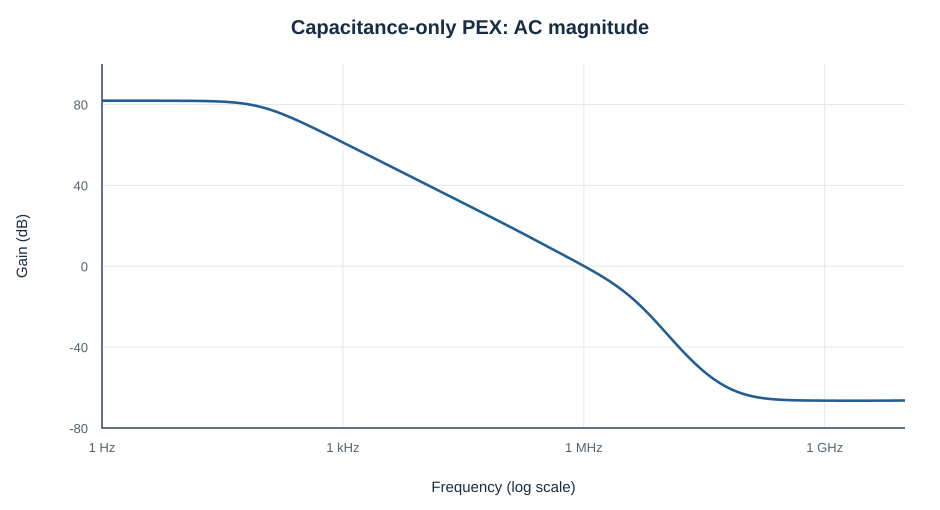
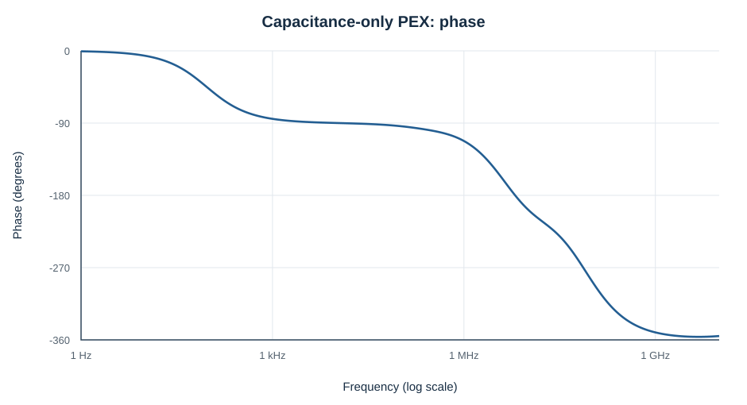
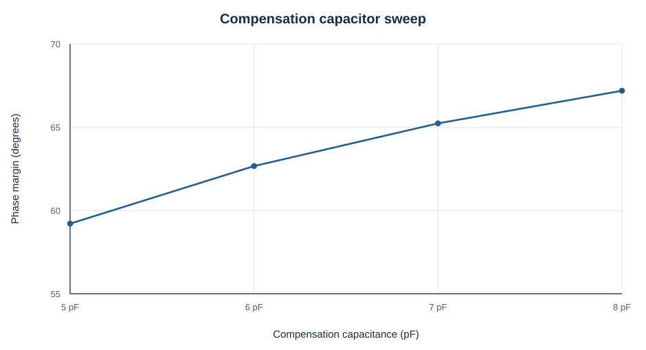
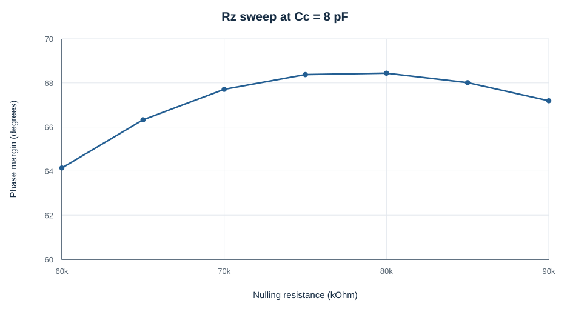

# Sky130 Two-Stage CMOS Operational Amplifier

Transistor-level design, physical layout, and parasitic-aware simulation of a **Miller-compensated two-stage CMOS operational amplifier** in the open-source SkyWater 130 nm process.

**Tools:** Xschem · Magic · ngspice · Netgen  
**Technology:** SKY130A · **Supply:** 1.8 V · **Output load:** 30 pF in the reported post-layout AC test

> **Project status:** Schematic and hierarchical Magic layout sources are included, together with an LVS comparison and capacitance-only / RC extraction outputs. The quantified AC result below is from **capacitance-only post-layout extraction**, not a validated full-RC simulation or a fabricated IC. The repository still requires path configuration and fresh end-to-end verification on another machine.

## AC performance

| Parameter | Reported value | Provenance |
|---|---:|---|
| Low-frequency gain | 81.85 dB | `results/ac/ac_summary.txt` |
| Unity-gain frequency | 1.013 MHz | Same |
| Phase margin | 67.45° | Same |
| Supply voltage | 1.8 V | `testbenches/postlayout/2stage_OL_pex.sch` |
| Output load | 30 pF | Same |
| Bias-reference current | 6 µA | Same |

The images above were generated from the uploaded `results/ac/ac_results.csv`. Phase is shown as an **unwrapped** angle.

## Compensation optimisation

Changing the compensation capacitance altered phase margin and unity-gain frequency. The uploaded capacitance sweep records 59.21° at 5 pF and 67.19° at 8 pF, with approximately 1.108 MHz and 1.091 MHz unity-gain frequency, respectively.

At **Cc = 8 pF**, the recorded compensation-resistor sweep peaks at approximately **68.44° phase margin with Rz = 80 kΩ** among the simulated points. The result at 85 kΩ is approximately 68.01°.

These sweeps document schematic-level design exploration; they are **not** independent full-RC post-layout results.

## Verification

- **LVS:** `verification/lvs/2stage_lvs.log` reports `Final result: Circuits match uniquely.` The comparison treats primitive device classes as black boxes; refer to the log for the matching methodology.
- **Layout:** `layout/2stage_final.mag` and seven referenced Magic child-cell `.mag` files are included. A copy of the top-level Magic file has five obsolete `~/projects/xschem_test` cell-location hints removed; no shapes were intentionally changed.
- **Parasitic extraction:** `extraction/2stage_pex.spice` is the capacitance-extracted network; `extraction/2stage_pex_rc.spice` contains explicit extracted resistance and capacitance.
- **DRC:** Final DRC output has not been included here.
- **Full-RC results:** A corrected, validated end-to-end full-RC simulation has not yet been provided.

## Repository contents

| Path | Contents |
|---|---|
| `schematic/` | Editable transistor-level Xschem schematic and symbol |
| `layout/` | Editable Magic top-level layout and required child cells |
| `testbenches/prelayout/` | AC, CMRR, PSRR, load, supply, power, transient and temperature analyses |
| `testbenches/postlayout/` | Original post-layout AC testbenches |
| `extraction/` | Generated post-layout SPICE extraction files |
| `verification/lvs/` | Schematic and layout netlists, LVS comparison log |
| `results/` | AC numeric results and compensation sweeps |
| `docs/figures/` | Plots generated from the uploaded data |
| `docs/known-issues.md` | Reproduction blockers and verification limitations |

## Opening / reproducing

1. Install a compatible **Sky130A PDK** and tools: Xschem, Magic, ngspice, and Netgen.
2. Set up the PDK and check your local Xschem symbol and model search paths.
3. Open `schematic/diffpair.sch` with Xschem after updating hard-coded paths in the testbenches.
4. Open `layout/2stage_final.mag` using a Magic working directory or cell search path that includes all files in `layout/`.
5. Review the setup details in [`docs/known-issues.md`](docs/known-issues.md) **before** re-running PEX simulations.

**Reproducibility warning:** The uploaded Xschem files contain `/home/ttuser/...` absolute paths. They have been retained rather than automatically rewritten without an EDA installation for validation. The file organisation is ready for review, but this package is not yet guaranteed plug-and-play on another workstation.

## Scope and limitations

This is an **open-source-PDK design and simulation project**, not silicon measurement. The published metrics must not be interpreted as fabricated-device test data, across-corner signoff, or completed RC-PEX signoff.